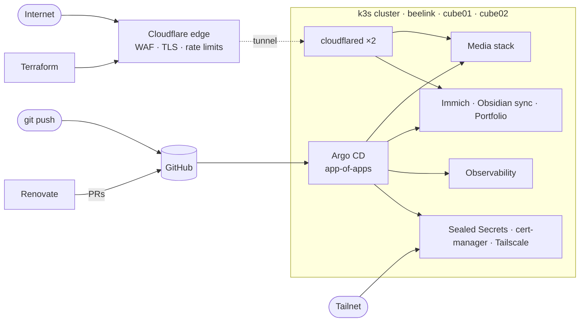

# homelab

**A three-node bare-metal Kubernetes cluster, run entirely from git.**

`Running since 2023` · `3 nodes, 2 architectures` · `15 Argo CD apps` · `72 pods` · `40 Renovate PRs merged`

Every workload, dashboard, firewall rule and secret in this cluster is declared in this repo. Push to `main`, and Argo CD rolls it out. Renovate keeps it up to date. Cloudflare keeps the public internet at arm's length. There is no click-ops.

It's a small production platform. It hosts a media pipeline that takes a request and ends with a subtitled stream, a private alternative to Google Photos, real-time note sync, and the website you may have come from. Each of these is deployed, monitored and upgraded the way you would want it done at work. The aim is not to have the most services; it's that the cluster could be wiped tonight and rebuilt from this repo tomorrow.

The repo covers three layers:

- **Applications.** Helm charts reconciled by Argo CD, with upstream charts wrapped where they fit and hand-written manifests where they don't.
- **Edge.** Cloudflare, managed with Terraform, handles TLS, WAF rules, IP allowlists and rate limiting before a request ever reaches the house.
- **Day two.** Metrics, logs, dependency updates and encrypted secrets are built in from the start rather than added later.

---

## Highlights

- **Fully GitOps.** One root Argo CD Application fans out into 15 apps. The repo *is* the cluster.
- **Edge as code.** Public traffic is routed through a Cloudflare Tunnel, with TLS policy, WAF rules, IP allowlists, rate limiting and AI-crawler blocking defined in Terraform.
- **Secrets in plain sight.** Credentials are committed encrypted as `SealedSecret`s, so they can only be decrypted inside the cluster.
- **Self-updating.** Renovate tracks every image tag, Helm chart and Terraform provider. Minor bumps merge themselves, and majors wait for a human.
- **Full observability.** Prometheus, Loki and InfluxDB all feed into Grafana, so metrics, logs and host telemetry sit side by side.
- **Configuration as code, all the way down.** Even the media apps' quality profiles and indexers are managed by Terraform, not set by hand in a web UI.

## Architecture

## What's running

| | |
| --- | --- |
| **Media** | Jellyfin, Emby, Sonarr, Radarr, Prowlarr, Bazarr, Seerr, Transmission. Hand-rolled manifests, no third-party charts |
| **Photos** | Immich, a self-hosted Google Photos with ML-powered search |
| **Notes** | Obsidian LiveSync on CouchDB, for real-time sync across devices |
| **Web** | My portfolio at [friis-jespersen.dev](https://friis-jespersen.dev) |
| **Observability** | kube-prometheus-stack, Loki + Promtail, Telegraf + InfluxDB2, Grafana |
| **Platform** | Sealed Secrets, cert-manager, Tailscale operator, Cloudflare Tunnel |

## Under the hood

**Hardware.** A mixed-architecture cluster: one x86 mini PC and two Raspberry Pis, all running k3s v1.32. A shared SSD is attached to `cube01` and NFS-mounted on the other nodes at the same path, so media pods can be scheduled anywhere and see the same library.

| Node      | Hardware               | Arch    | CPU | RAM   | OS                | Role                                  |
| --------- | ---------------------- | ------- | --- | ----- | ----------------- | ------------------------------------- |
| `beelink` | Beelink mini PC        | amd64   | 4   | 16 GB | Ubuntu 24.04 LTS  | Control plane, heavy workloads       |
| `cube01`  | Raspberry Pi           | arm64   | 4   | 8 GB  | Debian 12         | Worker, media SSD + NFS server        |
| `cube02`  | Raspberry Pi           | arm64   | 4   | 4 GB  | Debian 12         | Worker                                |

**GitOps.** `argocd/root.yaml` points at `argocd/apps/`, where each file is an Argo CD `Application`. Upstream Helm charts are wrapped in thin umbrella charts, so values, ingresses and secrets live next to the chart they belong to.

**Edge security.** `terraform/cloudflare` handles TLS 1.2+ enforcement, a WAF with an IP allowlist for the media apps, rate limiting, AI-crawler blocking, SPF/DMARC and tunnel routing.

**Access tiers.** Public apps go through Cloudflare. Internal tools are reachable only from the LAN or over Tailscale.

## Design decisions

**Sealed Secrets over a secrets manager.** Sealed Secrets keeps secrets in git next to the workloads that use them, encrypted with a key only the in-cluster controller holds. Even the Cloudflare tunnel token is a `SealedSecret`, so a rebuild needs nothing from outside the repo.

**TLS at Cloudflare's edge, not in the cluster.** Public traffic arrives through the tunnel and bypasses Traefik entirely, so cert-manager's HTTP-01 challenge could never complete, and a Let's Encrypt certificate quietly expired. Rather than wiring up DNS-01, the certificates were dropped: Cloudflare terminates TLS, enforces a 1.2 floor and HTTPS-only, and the tunnel keeps the hop to the cluster encrypted.

**Auto-sync on, prune and self-heal off.** Argo CD applies every change from git, but won't delete resources or revert live edits on its own. When restructuring charts (for example, changing a Deployment's selector, which Kubernetes can't patch in place), that leaves room to delete and migrate resources by hand without Argo CD racing to undo it. The trade-off is deliberate drift that has to be cleaned up manually.

## Built with

`k3s` · `Argo CD` · `Helm` · `Kustomize` · `Terraform` · `Cloudflare Tunnel` · `Tailscale` · `Sealed Secrets` · `Prometheus` · `Loki` · `Grafana` · `InfluxDB` · `Renovate`
